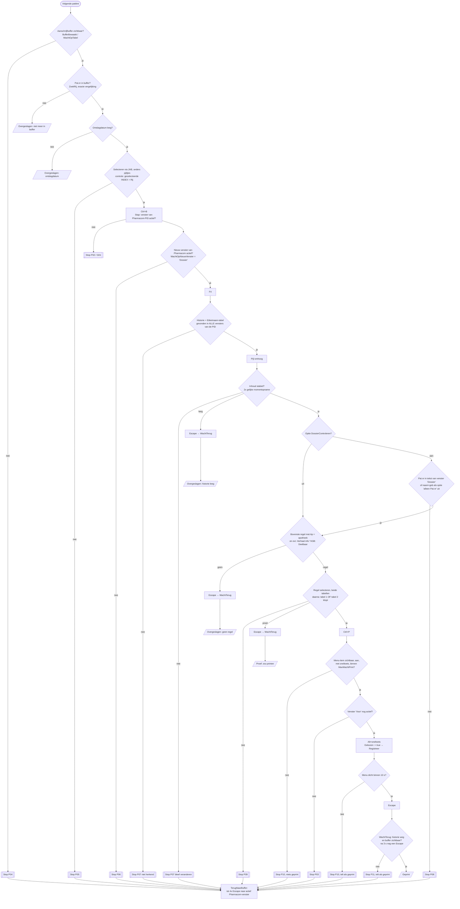

# Review: Etiketten autoprinter voor Pharmacom (v6.13)

*Externe review, 15-10-2026. Repository `ronaldsteenkamp/etiketten-autoprinter`, branch `main`,
commit `7251e9e`. De review heeft geen bestaande bestanden gewijzigd. Nieuwe bestanden staan alleen onder `review/`.*

**Zekerheid** per bevinding:

- **bevestigd**: uitgevoerd (AHK-probe, pytest of de bestaande tests), of de code laat geen andere lezing toe.
- **waarschijnlijk**: afgeleid uit de code, maar afhankelijk van gedrag dat ik niet kon nagaan.
- **vraag**: alleen de auteur kan het beantwoorden, meestal over hoe Pharmacom zich gedraagt.

De omgeving week af van de opdracht. Ik werkte op Windows 11 met AutoHotkey 2.0.28 (32-bit) en Python 3.12, en
Pharmacom draaide op dezelfde computer. Daarom heb ik de bestaande AHK-tests en eigen AHK-probes echt kunnen
draaien. **De app en de nep-Pharmacom heb ik bewust niet gestart.** Een ronde blokkeert toetsenbord en muis en
stuurt toetsen naar het actieve venster, en dat mocht niet gebeuren met de echte Pharmacom open.

---

## 1. Samenvatting

De code is zorgvuldig en goed leesbaar. Voor elke stap staat er een controle, er zijn vaste foutcodes, de Pat.nr's
worden exact vergeleken (bevestigd: `0123` ≠ `123`), `MaxWachtPrint` heeft een ondergrens en er wordt nooit
gekozen als het menu ontbreekt. Wel zijn er een paar paden waar het principe *"hij gokt nooit"* niet opgaat.
Ook mist de updateketen een controle op wie de nieuwe versie gemaakt heeft. **Top-5 risico's:**

1. **K1:** een programmafout tijdens een **geplande** ronde wordt in `Planning.Voer` opgevangen, zodat het vangnet niet afgaat. Toetsenbord en muis blijven geblokkeerd, `Ronde.Bezig` blijft aan en daarna draait geen enkele planning meer (bevestigd met een probe).
2. **K2:** meldt Pharmacom na de keuze "Barcode etiket" een probleem, dan klikt de app die melding weg met Escape en telt de patiënt als geprint. Dan is er een etiket gemist en ziet niemand het (waarschijnlijk/vraag).
3. **K3/K4:** het etiket is de *bovenste* regel van de eigen apotheek, ongeacht de sortering, de datum of de einddatum. De dossiercontrole kan per apotheek uit, en dan wordt na Ctrl+B niets meer gecontroleerd. Beide kunnen tot een verkeerd etiket leiden.
4. **H1/H2:** de medicatiehistorie en het afdrukmenu worden in *alle* vensters van Pharmacom gezocht, niet in het gecontroleerde dossier. Het Pat.nr wordt in *alle* tekst van het dossier gezocht, waardoor bijvoorbeeld een huisnummer kan matchen (bevestigd).
5. **H4/H5/H6:** even/oneven op het ISO-weeknummer verspringt na **week 53 van dit jaar** (28-12-2026). Daarnaast leidt één regel in de gedeelde ini de updates om (`[Update] GitHub=`), en de app controleert alleen een SHA-256 die uit dezelfde bron komt als het bestand.

---

## 2. Toestandsmodel van één patiënt

Bron: `Ronde.PrintPatient` (src/Ronde.ahk:374-538), `Ph.*` (src/Pharmacom.ahk) en `Ronde.StartRun` (src/Ronde.ahk:185-368).

Op elk moment geldt verder het volgende:

- Met **Esc** of Stop gaat `Ronde.Stoppen` aan. De volgende `Stap` of wachtlus stopt dan met G01.
- Sluit **Pharmacom**, dan stopt de ronde met P01 (`Ph.JavaAfgesloten`).
- Bij een **programmafout** buiten een `try` grijpt het vangnet in met X99 (`Vangnet`). Bij een geplande ronde gebeurt dat niet, zie K1.
- Blijft het levensteken 20 s uit terwijl de invoer geblokkeerd is, dan sluit de **waakhond** de app af.

**Naast LEESMIJ ("Wat de app per patiënt doet", LEESMIJ.md:138-156):** de stappen kloppen. Er zijn wel drie
verschillen. (a) LEESMIJ stelt de dossiercontrole voor als vaste stap, maar het is een optie (`Inst.Optie("controle")`,
src/Ronde.ahk:465). (b) LEESMIJ zegt dat de regel "in beide helften gecontroleerd" wordt. De laatste controle vlak voor
het printen gebruikt echter *of* (src/Ronde.ahk:503). (c) De overslagpaden (lege historie, geen eigen regel,
ontslagdatum) en de extra Escape na 3 s in `WachtTerug` staan niet in LEESMIJ.

---

## 3. Bevindingen

Ernst: **Kritiek** = kan leiden tot een etiket voor de verkeerde patiënt, voor het verkeerde medicijn of tot een gemist etiket.

| ID | Ernst | Categorie | Bestand:regel | Beschrijving | Zekerheid | Aanbeveling |
|---|---|---|---|---|---|---|
| K1 | Kritiek | Patiëntveiligheid / Robuustheid | src/Planning.ahk:456-541, src/Ronde.ahk:256 en 325-329, Etiketten_autoprinter.ahk:88 en 196 | Een fout in `StartRun`/`PrintPatient` tijdens een geplande ronde wordt gevangen door `try … catch` in `Planning.Voer`. `OnError Vangnet` gaat dan niet af. Toetsenbord en muis blijven geblokkeerd, `Ronde.Bezig`, `Wakker` en `RondeTijd` blijven aan en een al gekozen etiket wordt niet geregistreerd. Omdat `Ronde.Bezig` aan blijft, slaan `Planning.Tik` en `Bewaking` alles over: geen planning meer tot de app herstart. | **Bevestigd** (review/probes/Probe_vangnet_planning.ahk: na `Voer` geldt `Bezig=1, blokkade=1`, handmatig wel `0/0`) | De opruimcode van het vangnet in een functie `Ronde.Noodstop(e)` zetten en aanroepen in de `catch` van `Planning.Voer`, of beter: in `StartRun` zelf een `try/finally` om de lus (blokkade eraf, Bezig uit, Gekozen registreren). Test S22. |
| K2 | Kritiek | Patiëntveiligheid | src/Pharmacom.ahk:419-432, 438-463; src/Ronde.ahk:523-537 | Na Alt+B gaat `Gekozen` aan en daarna volgt blind een Escape naar elk venster van Pharmacom. Toont Pharmacom een melding (printer niet bereikbaar, geen etiketprinter, waarschuwing), dan sluit die Escape de melding. Na 3 s volgt nog een Escape voor het dossier. De patiënt staat dan als *Geprint* in het register en het rapport, er komt geen etiket en niemand heeft de melding gezien. | Waarschijnlijk (het codepad is eenduidig; of zulke meldingen bestaan, is een **vraag**) | Vóór de Alt-toets de lijst vensters van Pharmacom vastleggen. Na het sluiten van het menu stoppen (nieuwe code, bijv. P12) als er een nieuw venster is of het actieve venster niet het dossier is, en die melding laten staan. Escape alleen naar `Dossier` (`WinActive("ahk_id " Dossier)`). Test S12. |
| K3 | Kritiek | Patiëntveiligheid | src/Ronde.ahk:474-484 | Het etiket is de **bovenste** regel met Ap = apotheek, dus wat Pharmacom op dat moment bovenaan toont. De app controleert de sortering, de datum (Laatste V/A) en de einddatum niet. Sorteert iemand de historie op een andere kolom, dan krijgt de patiënt een ander medicijn op het etiket. Ook de nep-Pharmacom zet de oudere AN-regel bovenaan (tests/NepPharmacom.js:63-71: METFORMINE 02-09 boven SIMVASTATINE 04-09). | Vraag (hoe sorteert Pharmacom, en blijft dat zo?). Het gedrag zelf is bevestigd in review/tests_voorstel (`test_bovenste_regel_is_niet_de_nieuwste`) | De kolom "Laatste V/A" mee uitlezen (staat al in de linker tabel). Kies de nieuwste regel van de eigen apotheek, of stop als de regels niet aflopend op datum staan. Beslis hoe een regel met een einddatum in het verleden behandeld moet worden. Test S14. |
| K4 | Kritiek | Patiëntveiligheid | src/Ronde.ahk:384-394 en 465-469; src/Instellingen.ahk:33, 117 | (a) De dossiercontrole is een optie per apotheek (`DossierControleren`). Staat die uit, dan is na Ctrl+B nergens meer gecontroleerd dat het dossier van de juiste patiënt is. (b) Na het selecteren in de buffer wordt alleen de *index* gecontroleerd, niet dat de geselecteerde regel nog dit Pat.nr heeft. Verandert de buffer tussen `ZoekRij` en de selectie (verversen, een regel erbij), dan gaat Ctrl+B naar een andere patiënt. | Bevestigd (code). De kans bij (b) is een **vraag** (ververst de buffer zichzelf?) | De controle niet uitschakelbaar maken, of bij "uit" weigeren te printen (alleen proef). Na `Ph.Selecteer` opnieuw `t.Cel(t.Geselecteerd(), "patnr") = p.patnr` controleren. Test S1, S2 en S21. |
| H1 | Hoog | Patiëntveiligheid | src/Jab.ahk:148-166 en 224-256; src/Ronde.ahk:417 en 497; src/Pharmacom.ahk:392 en 400 | De dossiercontrole leest venster `Dossier`. De historietabellen (`ZoekTabellen`) en het menu (`ZoekMenuItem`) worden echter gezocht in **alle** vensters van het Pharmacom-proces, en het eerste dat past, telt. `PrintEtiket` neemt als `Voor` het actieve venster, niet het gecontroleerde `Dossier`. Staan er twee dossiers open, dan kunnen de controle en de regelkeuze over verschillende patiënten gaan. | Bevestigd (code). Of Pharmacom twee dossiers tegelijk toestaat, is een **vraag** | `Doorzoek` een optionele Hwnd geven en de historie en het menu alleen in `Dossier` zoeken. In `PrintEtiket` het dossier meegeven en `WinActive(Dossier)` eisen. Test S5. |
| H2 | Hoog | Patiëntveiligheid | src/Pharmacom.ahk:345-369; src/Jab.ahk:361-403 | Het Pat.nr wordt gezocht in alle labels en velden van het dossiervenster (behalve tabellen). Een Pat.nr dat toevallig als huisnummer, telefoonnummer of ander getal in beeld staat, telt als bevestiging. Bij "naam + geboortedatum" is de naamcontrole een `InStr` op een deel van de naam: "Jong" past ook bij "Jongeneel". | **Bevestigd** (probes: `Dorpsstraat 123` en `Tel. 06-123` passen bij Pat.nr 123; pytest `test_patnr_patroon_in_vrije_tekst`). De kans hangt af van de lengte van Pat.nr's (vraag) | Het Pat.nr-veld zelf zoeken (label "Pat.nr" + waarde, of het element met die naam) en exact vergelijken. Naam + geboortedatum niet als alternatief gebruiken, of alleen met exacte achternaam als woord. |
| H3 | Hoog | Patiëntveiligheid | src/Ronde.ahk:256 en 499-504; src/Pharmacom.ahk:214-227 en 416-421 | Blokkeren van de invoer is een optie per computer (`InvoerBlokkeren`). Staat die uit, dan kan een klik in Pharmacom tussen de regelcontrole en Ctrl+P/Alt+B de selectie verplaatsen. Dan wordt het etiket van een andere regel geprint. De laatste controle (regel 503) accepteert al dat *één* van de twee tabellen goed staat. | Bevestigd (code) | Bij echt printen de blokkade verplicht maken. Vlak vóór de Alt-toets de selectie in beide tabellen opnieuw controleren (`h` en `e` bewaren tot na het kiezen). Test S6 en S7. |
| H4 | Hoog | Planning | src/Planning.ahk:188-195 | "Even/oneven week" volgt het ISO-weeknummer. 2026 heeft week 53, dus **28-12-2026 en 4-1-2027 zijn allebei oneven**. Een oneven planning draait dan twee weken achter elkaar. Bij een even planning zitten er drie weken tussen (21-12 → 11-1). Groepen "2 WEKELIJKS" krijgen dan een week te vroeg of te laat hun etiketten. Volgende keren: 2032 en 2037. | **Bevestigd** (probe en pytest `test_week53_*`) | Tweewekelijks tellen vanaf een vaste ankerdatum per planning (voorstel `tweewekelijks_klopt`, getest). Op korte termijn: vóór 28-12-2026 de betrokken planningen nalopen en de gebruikers waarschuwen. |
| H5 | Hoog | Update / Supply chain | src/Update.ahk:38; src/Instellingen.ahk:91-104 | `[Update] GitHub=eigenaar/naam` wordt gelezen uit de **gedeelde** ini in de netwerkmap. Die moet voor alle gebruikers schrijfbaar zijn (planning, groepen, opties). Wie daar één regel toevoegt, laat alle lokale installaties een "update" uit een eigen repository aanbieden, inclusief een passende `.sha256`. | Bevestigd (code) | De bron vast in de .exe zetten (`AppGitHub`) en de ini-override schrappen, of alleen uit de eigen ini lezen. Zie ook H6. |
| H6 | Hoog | Update / Supply chain | src/Update.ahk:183-226; .github/workflows/release.yml:94-104 | De verwachte SHA-256 komt uit dezelfde release (of dezelfde map) als de .exe. Dat beschermt tegen een kapotte download, niet tegen een gecompromitteerde release, een gestolen token of een verkeerde netwerkmap. De app controleert vóór het uitvoeren geen Authenticode-handtekening en geen herkomstbewijs. | Bevestigd (code) | Vóór het vervangen `WinVerifyTrust` uitvoeren en het onderwerp of de vingerafdruk van het SignPath-certificaat vastpinnen. Zolang er niet ondertekend wordt: een publieke sleutel in de .exe en een handtekening over de hash in de release (bijv. minisign), of de hash van de volgende versie meeleveren. |
| M1 | Middel | Patiëntveiligheid (dubbel) | src/Opslag.ahk:18, 68-85; src/Ronde.ahk:76 en 527 | Het register wordt alleen gelezen bij het inlezen van de lijst, niet vlak vóór elke patiënt. Er is geen vergrendeling tussen computers. `Registreer` slikt schrijffouten (`try FileAppend`). Is de gedeelde map bij het starten weg, dan wijkt `Hoofdmap()` stil uit naar de map van de app, met een eigen register. Gevolg: dubbele etiketten (planning op pc A + handmatig op pc B, netwerkstoring). | Bevestigd (code) | Register vlak vóór elke patiënt opnieuw lezen. Bij een mislukte registratie de ronde stoppen. Met een lockbestand per groep en dag voorkomen dat twee computers tegelijk dezelfde groep printen. Bij uitwijken naar een lokale map niet printen of duidelijk waarschuwen. Test S23 en S24. |
| M2 | Middel | Privacy | src/Ronde.ahk:468, 353 en 345-355; src/Planning.ahk:531; LEESMIJ.md:250 | Bij P08 staat de **patiëntnaam** in de stopreden. Die gaat naar het log, naar de planningstatus in `Gegevens\Computers\<pc>.ini` (die nooit opgeruimd wordt) en naar een Windows-melding. LEESMIJ zegt dat het log "alleen Pat.nr's" bevat. | Bevestigd (code) | In `Fout(...)` alleen het Pat.nr gebruiken en de naam alleen in het venster tonen. De planningstatus zonder vrije tekst uit Pharmacom opslaan. |
| M3 | Middel | Privacy | src/Opslag.ahk:28-33; src/Hulp.ahk:170-177; src/Instellingen.ahk:83-84 | Opruimen gebeurt alleen bij het **starten** van de app. Met *Starten met Windows* kan de app wekenlang draaien zonder op te ruimen. "> 30 dagen" met afgekapte dagen betekent in de praktijk 31 dagen of meer. `RapportDagen=0` in de gedeelde ini zet opruimen helemaal uit, en er is geen bovengrens. `Gegevens\Computers\*.ini` wordt nooit opgeruimd. | **Bevestigd** (probe en pytest `test_opruimen_effectief_31_dagen`) | Dagelijks opruimen (timer). Een maximum op de termijnen (bijv. 90). Voor de bewaartermijnen van LEESMIJ ">=" gebruiken of de tekst aanpassen. |
| M4 | Middel | Planning | src/Planning.ahk:202 en 240 | Een planning draait alleen op `it.computer`, en alleen die computer meldt gemiste rondes. Is die computer hernoemd of vervangen, dan draait de groep nooit meer en meldt **geen enkele** computer iets. | Bevestigd (code) | Elke computer meldt rondes die op een computer staan die al > 1 dag niet "gezien" is (`Staat.Computers()`). Een groep zonder geldige computer als fout tonen. |
| M5 | Middel | Patiëntveiligheid / Robuustheid | src/Pharmacom.ahk:258-276 en 483-514; src/Zoekvelden.ahk:232-240 | `WachtOpNieuwVenster` ziet elk nieuw venster van Pharmacom als "het dossier", ook een waarschuwing. `TerugNaarBuffer` stuurt tot 4 Escapes naar elk actief venster van Pharmacom. `ZetVeld` sluit elk nieuw venster met Escape. Waarschuwingen van Pharmacom kunnen zo ongezien verdwijnen. Bij een geplande ronde gaat de app daarna zelf verder (P08 geldt als herstartbaar). | Waarschijnlijk (of zulke meldingen bestaan, is een **vraag**) | Het dossier herkennen aan de titel of inhoud. Onbekende vensters niet wegklikken maar stoppen en ze laten staan. Bij een onbekend venster niet zelf herstarten. Test S13. |
| M6 | Middel | Update / Supply chain | .github/workflows/tests.yml:16-22; release.yml:29, 41-47, 67, 74, 102 | Actions vastgezet op een tag (`@v4`, `@v2`, `@v1`) in plaats van een commit-SHA. AutoHotkey en Ahk2Exe (`1.1.37.02a2`, een alpha) worden zonder hashcontrole gedownload. `checkout` bewaart de token, en in release.yml draaien de tests met `contents: write`. | Bevestigd (code) | Zie review/tests_ci_voorstel.yml: SHA-pinning (opgehaald 15-10-2026), hashcontrole, `persist-credentials: false`, een definitieve Ahk2Exe-versie, Dependabot voor actions. |
| M7 | Middel | Update / Supply chain | Hulpmiddelen/maak_release.ps1:79-83 | Het script meldt "Herkomstbewijs: NIET bevestigd" of een ongeldige handtekening, maar zet de .exe daarna toch in de netwerkmap. | Bevestigd (code) | Bij een mislukte attestation (en, zodra SignPath werkt, bij een ongeldige handtekening) stoppen met `throw`. |
| M8 | Middel | Test | tests/*.ahk; .github/workflows/tests.yml | De unit-tests (105) dekken de hulpfuncties, de planningslogica en het uitlezen van een release. Niets dekt `Ronde`, `Ph`, `Jab` of `PhZoek`, waar de patiëntveiligheid zit. De nep-Pharmacom is alleen handmatig en draait niet in CI. Geen enkele test dekt K1–K4, H1–H3 of M1. | Bevestigd (uitgevoerd: 45 + 51 + 9 geslaagd) | Scenario's in review/tests_voorstel/NepPharmacom_scenarios.md. De E2E-proefballon in review/tests_ci_voorstel.yml. |
| M9 | Middel | Patiëntveiligheid | src/Pharmacom.ahk:24 | `^ASB:\s*Deelbaar` is een voorvoegsel: "ASB: Deelbaar niet" en "asb:deelbaarheid…" passen ook. | Bevestigd (probe en pytest). Of zulke waarden voorkomen, is een **vraag** | Exact vergelijken (`^ASB:\s*Deelbaar\s*$`), of de bekende waarden opsommen. |
| M10 | Middel | Proces | README.md:54-55; .github/workflows/release.yml:14-16 | Eén persoon is committer, reviewer en approver. Elke gepushte tag `v*` wordt meteen een release die alle installaties aanbieden. Er is geen goedkeuringsstap of tweede paar ogen. | Bevestigd (docs en code). Of er branch- of tagbescherming is, is een **vraag** | GitHub-environment `release` met een verplichte reviewer (bijv. een tweede apotheker of de ICT). Tag-bescherming. Een korte releasechecklist (proefronde op de nep en in Pharmacom). |
| M11 | Middel | Proces / Privacy | src/Planning.ahk:344-359; LEESMIJ.md (Planning, Uitstel) | Een onbeheerde ronde vraagt om een **ontgrendelde** pc met Pharmacom open. Vergrendelen stelt de ronde alleen uit. Dat nodigt uit om automatisch vergrendelen uit te zetten. In Pharmacom staan de acties op naam van de ingelogde medewerker (logging van dossierinzage). | Waarschijnlijk | In de risicoanalyse vastleggen. Bijv. een aparte, beperkte werkplek of account, een fysiek afgeschermde plek, en afspraken over wie er ingelogd is. |
| L1 | Laag | Planning | src/Planning.ahk:204-209, 616 | Een ongeldige tijd uit de ini (bijv. `25:00` of `8:99`) passeert de regex. `DateDiff` gooit dan een fout, elke 20 s, en via het vangnet volgt elke keer een X99-melding. De pagina controleert de tijd, de AHK-kant niet. | **Bevestigd** (probe) | Uren en minuten begrenzen in `NuAan`, `Momenten` en `SecondenTot` en bij het opslaan. |
| L2 | Laag | Planning | src/Planning.ahk:199-214 | Een planning tussen 02:00 en 03:00 op de dag van de zomertijd bestaat niet en wordt als *gemist* gemeld. In de herfst kan hij niet dubbel draaien (één keer per dag). | Bevestigd (probe en pytest) | Documenteren, of tijden tussen 02:00 en 03:00 weigeren. |
| L3 | Laag | Privacy / Security | src/Opslag.ahk:93-100 | CSV-waarden worden tussen aanhalingstekens gezet, maar een waarde die met `=`, `+`, `-` of `@` begint, wordt in Excel een formule (CSV-injectie). De bron is Pharmacom, dus de kans is klein. | Bevestigd (probe en pytest) | Voorloop-`'` bij die tekens (voorstel `csv_veilig`). |
| L4 | Laag | Update | src/Hulp.ahk:41-47; src/Update.ahk:168 | `VersieNummer` telt maar drie delen van 0-999. Een tag `6.13.0.1` is "niet nieuwer" en `6.1000` loopt over. Een versie terugzetten (downgrade) kan niet (alleen `>`). | Bevestigd (probe en pytest) | Per deel vergelijken, en tags strikt `^v\d+\.\d+$` laten zijn (ook in release.yml). |
| L5 | Laag | Security | src/Venster.ahk:39-55; ui/venster.html:389 | De HTML-escaping is consequent (`esc()` op alle data). DevTools, het contextmenu en de sneltoetsen van de browser staan uit. Wat ontbreekt als extra laag: een `NavigationStarting`-handler die navigatie weg van de eigen pagina blokkeert, een CSP, en een allowlist voor berichten uit de pagina. Elke pagina in de WebView kan nu `knop/start` sturen. | Bevestigd (gelezen) | De navigatie blokkeren en `<meta http-equiv="Content-Security-Policy" content="default-src 'none'; img-src data:; style-src 'unsafe-inline'; script-src 'unsafe-inline'">` toevoegen. |
| L6 | Laag | Privacy | src/Pharmacom.ahk:131-147 en 467-478 | Vensterteksten van Pharmacom komen in het log (`LogToestand`) en in de planningstatus (`Gereed`). Staat er een patiëntnaam in een titel, dan staat die ook in het log. | Vraag (titels van dossiers en meldingen) | Titels inkorten tot een bekende lijst, of alleen tellen. |
| L7 | Laag | Patiëntveiligheid | src/Pharmacom.ahk:26, 167-170; src/Jab.ahk:345-355 | De ingelogde apotheek is het eerste label in een willekeurig venster van Pharmacom dat op `X - Y - Z` past, niet specifiek de statusbalk. Een ander label kan `T1 - GUA - 3` heten. Dan wordt T1 gelezen en wordt geen enkele regel gekozen (veilig, maar alles wordt overgeslagen). | Waarschijnlijk (pytest `test_apotheek_case_en_patroon`) | Alleen in het hoofdvenster en de statusbalk zoeken. |
| L8 | Laag | Robuustheid | src/Update.ahk:110; src/Venster.ahk:212-231 | De updatevraag bij het starten heeft geen time-out. Dialogen wachten in een `Sleep`-lus. Komt er intussen een geplande ronde met een eigen dialoog, dan wacht de oudere dialoog op een antwoord dat niet meer getoond wordt. | Waarschijnlijk | Eén dialoog tegelijk (een wachtrij), of bij een nieuwe dialoog de vorige beantwoorden met "Later". |
| L9 | Laag | Update | .github/workflows/release.yml:64-92 | Zonder SignPath-instellingen wordt de stap overgeslagen en verschijnt er stil een niet-ondertekende release. | Bevestigd | Bij een release-tag zonder handtekening falen, of dit in de releasetekst zetten. |
| L10 | Laag | Docs | LEESMIJ.md:244 en 255 | De tabel Mappen noemt `tests\Update.ahk`, `NepPharmacom.js` en `alle_tests.ps1` niet. `Archief\` zou v5.7.2 bevatten, maar de repo heeft alleen de v4- en v5.8.0-broncode. | Bevestigd | Bijwerken. |
| L11 | Laag | Robuustheid | Archief/ | 3.583 regels oude broncode (v4, v5.8.0 in AHK v1). Git bewaart de geschiedenis al. | Bevestigd | Verwijderen, of een tag op de laatste v5-commit zetten. |
| L12 | Laag | Update | src/Update.ahk:125-133 en 213-217 | Het hulpscript en de gecontroleerde kopie staan onder een vaste naam in `%TEMP%`. Tussen de controle en de kopie zit tot 30 s. Alleen hetzelfde gebruikersaccount kan erbij, en dat kan de lokale .exe ook zelf vervangen. | Waarschijnlijk | De hash opnieuw controleren in het hulpscript (`certutil -hashfile`), of de kopie met een unieke naam alleen-lezen openen. |
| L13 | Laag | Planning | src/Planning.ahk:22, 571-574 | Uitgestelde rondes staan alleen in het geheugen. Na een herstart van de app wacht een uitgestelde ronde niet meer (die wordt wel als "niet uitgevoerd" getoond). | Bevestigd | Documenteren, of de uitgestelde rondes in `Staat` bewaren. |
| L14 | Laag | Patiëntveiligheid | src/Ronde.ahk:86, 387-389 | Elke ontslagdatum, ook een datum in de toekomst, betekent "overslaan". | Vraag (komt een toekomstige ontslagdatum voor?) | Vergelijken met vandaag, of zo laten en documenteren. |
| L15 | Laag | Robuustheid | src/Instellingen.ahk:182-191 | Wachttijden mogen 0 of negatief zijn (alleen `MaxWachtPrint` heeft een minimum). Dat is veilig, want de app stopt dan eerder, maar het geeft verwarrende stops. | Bevestigd | Een ondergrens van 0 voor alle wachttijden en minima voor `MaxWacht*`. |

### Wat goed is (en zo moet blijven)

- Het **Pat.nr** wordt exact vergeleken, zonder getalconversie (probe: `0123` ≠ `123`, `"0183" != "183"`). Het register gebruikt exacte sleutels.
- Is het **menu-item** er niet, uitgeschakeld of zonder sneltoets, dan stopt de app zonder te kiezen. Er wordt pas *na* de keuze geregistreerd, en het menu moet eerst dicht zijn vóór de Escape.
- **`MaxWachtPrint`** heeft een ondergrens van 1000 ms (src/Instellingen.ahk:29, 70-73, 186-187).
- De **ontslagdatum** wordt vlak vóór het selecteren opnieuw gelezen (src/Ronde.ahk:387).
- De **blokkade** gebruikt alleen sneltoetsen in het eigen proces. Stopt het proces, dan is de blokkade ook weg. Ctrl+Alt+Del werkt altijd, en de waakhond vangt een app die hangt.
- **Issues op GitHub** krijgen alleen foutcodes en aantallen, geen namen, computernamen of logregels (src/Venster.ahk:308-319). Het formulier waarschuwt er zelf voor.
- De **privacyverklaring** in de README klopt met het netwerkverkeer dat ik in de code vond: api.github.com, downloads van GitHub (alleen na een klik) en de netwerkmap. Teams en mail worden alleen geopend op verzoek van de gebruiker.

---

## 4. Faalwijzenanalyse (FMEA-light)

| Stap | Mogelijke faalwijze | Bestaande detectie in de code | Restrisico |
|---|---|---|---|
| 0. Start ronde | Verkeerde apotheek ingelogd; gedeelde map weg | `LeesApotheek` ≠ "" (en bij een planning gelijk aan de bekende); waarschuwing als de gedeelde ini ontbreekt | Register lokaal bij uitwijken (M1); apotheek uit het verkeerde label (L7) |
| 0b. Planning | Verkeerde week (week 53), pc hernoemd, ongeldige tijd, pc vergrendeld | Vooraf-controle, uitstel tot 2 uur, melding van gemiste rondes | **H4** (dit jaar), M4, L1 |
| 1. Patiënt in buffer | Buffer verandert tussen opzoeken en selecteren | Controle op de geselecteerde index | **K4b**: geen hercontrole van het Pat.nr |
| 2. Ctrl+B | Melding in plaats van dossier; dossier van een andere patiënt | Nieuw venster van de PID; time-out P06 | M5 (melding als dossier), K4a als de controle uit staat |
| 3. F4 en historie | Historie uit een ander venster; laadt traag | Stabiliteit (2x gelijk), lege historie apart | **H1** (tabel buiten het dossier) |
| 4. Dossiercontrole | Pat.nr toevallig elders in beeld; naam als deel van een andere naam | Pat.nr met cijfergrenzen; standaard alleen Pat.nr | **H2**; controle uitschakelbaar (K4a) |
| 5. Regelkeuze | Andere sortering, gestopte medicatie, "Deelbaar niet" | Ap exact (hoofdletterongevoelig), Deelbaar-regex | **K3**, M9 |
| 6. Regel selecteren | Selectie verspringt (klik zonder blokkade, focus) | Beide tabellen bij het selecteren; daarna één van de twee | **H3** |
| 7. Ctrl+P en keuze | Menu ontbreekt, staat uit of komt te laat; toets in een ander venster | Item, aan en sneltoets; `Voor` actief; `MaxWachtPrint` | Laag. `Voor` ≠ gecontroleerd dossier (H1) |
| 8. Na de keuze | Pharmacom meldt een printprobleem | Wacht tot het menu dicht is | **K2**: Escape klikt de melding weg, telt als geprint |
| 9. Terug naar buffer | Dossier blijft open; melding open | Na 3 s nog een Escape (alleen als het dossier actief is); P11 | M5 (Escapes in `TerugNaarBuffer`) |
| 10. Registratie | Schrijffout; twee computers tegelijk | Register bij het inlezen van de lijst; "al geprint"-vraag | **M1** |
| X. Programmafout | Uitzondering in de ronde | Vangnet X99 (handmatig) | **K1** (gepland: geen vangnet) |
| X. App hangt | JAB-aanroep hangt | Waakhond na 20 s, melding met Pat.nr | Etiket mogelijk niet geregistreerd (de melding zegt dat) |
| X. Afsluiten | Pharmacom dicht, app sluit | P01 via JAB-melding; `Afsluiten` haalt de blokkade eraf | Laag |

---

## 5. Aanbevelingen in volgorde

Moeite: **S** < 1 uur · **M** een dagdeel tot 2 dagen · **L** meer.

**A. Patiëntveiligheid**

1. **K1:** `try/finally` in `Ronde.StartRun` om de lus. De afronding (blokkade, `Bezig`, registratie bij `Gekozen`) staat dan op één plek, die ook het vangnet gebruikt. Daarna test S22. *(S–M)*
2. **K2/M5:** vóór Alt+B de vensters van Pharmacom vastleggen. Daarna geen Escape naar onbekende vensters, maar stoppen met een nieuwe code (bijv. P12) en de melding laten staan. *(M)*
3. **K4:** dossiercontrole altijd aan bij echt printen. Na het selecteren in de buffer het Pat.nr van de geselecteerde regel opnieuw lezen. *(S)*
4. **H1:** historie en menu alleen in het venster `Dossier` zoeken. `PrintEtiket(Dossier)`. *(M)*
5. **K3:** regel kiezen op de nieuwste Laatste V/A van de eigen apotheek, of stoppen als de sortering niet aflopend is. Bepalen wat er met een einddatum gebeurt. *(M)*
6. **H2:** Pat.nr alleen in het Pat.nr-veld controleren. Naam + geboortedatum als alternatief schrappen. *(M)*
7. **H3:** blokkade verplicht bij echt printen. Selectie in beide tabellen opnieuw controleren vlak vóór de Alt-toets. *(S)*
8. **M1:** register vóór elke patiënt lezen, stoppen bij een schrijffout, lock per groep en dag. *(M)*
9. **H4:** vóór 28-12-2026 de tweewekelijkse planningen nalopen en de gebruikers informeren *(S)*. Daarna een ankerdatum per planning *(M)*.

**B. Updateketen**

10. **H5:** `[Update] GitHub` niet meer uit de gedeelde ini lezen. *(S)*
11. **H6:** Authenticode controleren (`WinVerifyTrust` + vastgepind certificaat) zodra SignPath actief is, of een eigen handtekening over de hash. *(M)*
12. **M7/L9:** `maak_release.ps1` en release.yml laten falen zonder herkomstbewijs of handtekening. *(S)*
13. **M6/M10:** actions op SHA, hashcontrole op AHK en Ahk2Exe, `persist-credentials: false`, een release-environment met een tweede goedkeurder. *(S + organisatorisch)*

**C. Quick wins (< 1 uur per stuk)**

14. M2: geen naam in `Fout(...)` en de planningstatus. · M9: Deelbaar exact. · L1: uren en minuten begrenzen. · L3: `csv_veilig`. · L5: navigatie blokkeren en CSP. · M3: dagelijkse opruimtimer en maximale termijnen. · L10: LEESMIJ bijwerken. · L11: `Archief/` weg.

**D. Structureel**

15. De scenario's S1–S25 in de nep-Pharmacom inbouwen, en een E2E-job in CI (proefballon in `review/tests_ci_voorstel.yml`). *(L)*
16. Een validatieprotocol per Pharmacom-versie: vaste proefronde op de nep en daarna een proefronde in Pharmacom, met afvinklijst. Opnieuw uitvoeren bij elke Pharmacom-update. *(M, proces)*
17. M4: bewaking van "wees"-planningen. L8: één dialoog tegelijk. *(M)*

---

## 6. Regelgeving en procesborging *(signalering, geen juridisch advies; alles: te laten beoordelen)*

- **MDR (EU 2017/745).** De tool kiest zelf welk medicatie-etiket geprint wordt. Of dat software met een medisch doel is (MDCG 2019-11), of alleen automatisering van handelingen die de medewerker anders zelf doet, moet beoordeeld worden. Mogelijk geldt de vrijstelling voor eigen gebruik in een zorginstelling (art. 5 lid 5), met eigen eisen (documentatie, risicobeheer). *Te laten beoordelen.*
- **NEN 7510.** Hier horen bij: een risicoanalyse (deze FMEA), change management en scheiding van taken bij releases (M10), toegangsbeheer op de netwerkmap en de gedeelde ini (H5), leveranciersbeheer (GitHub, SignPath, AutoHotkey-bibliotheken), onbeheerde ontgrendelde werkplekken (M11) en logging en bewaartermijnen (M2, M3). *Te laten beoordelen.*
- **NEN 7513 en de WGBO.** De app opent per patiënt het dossier onder het account van de ingelogde medewerker. Dat komt in de inzagelogging van Pharmacom terecht als inzage door die medewerker. Leg vast dat dit een geautomatiseerde handeling is en voor welk doel, zodat controles van die logging het kunnen verklaren. *Te laten beoordelen.*
- **NEN 7512.** Weinig raakvlak: de enige uitwisseling naar buiten is het opvragen van de nieuwste release bij GitHub, zonder patiëntgegevens.
- **AVG.** Het CSV-rapport (naam en geboortedatum) en het log met Pat.nr's staan op een netwerkmap. Leg vast wie daar bij kan, of de bewaartermijnen kloppen (M3), of opname in het verwerkingsregister nodig is, en of er een korte DPIA-toets nodig is. *Te laten beoordelen.*
- **De leverancier (PharmaPartners).** Pharmacom wordt via de Java Access Bridge bediend. Ga na of de voorwaarden van PharmaPartners dat toestaan, en valideer opnieuw bij elke Pharmacom-versie (kolomnamen, menu-items, meldingen). *Te laten beoordelen.*
- **Wie geeft vrij?** Nu: de auteur alleen (README.md:54-55). Advies: de apotheker of procesverantwoordelijke keurt een release goed na een vastgelegde proefronde.

---

## 7. Open vragen voor de auteur

1. **Sortering (K3):** hoe sorteert Pharmacom de medicatiehistorie standaard? Blijft een sortering die de gebruiker kiest bewaard (per dossier, per gebruiker)? Moet "bovenste" de nieuwste verstrekking zijn of iets anders?
2. **Einddatum (K3):** mag een regel met een *Th. einddatum* in het verleden een etiket krijgen?
3. **Meldingen na het printen (K2):** toont Pharmacom ooit een melding of venster na "Barcode etiket", zoals printer offline, geen etiketprinter of een bevestiging? Zo ja, welke titels?
4. **Meldingen bij het openen (M5):** toont Pharmacom bij Ctrl+B soms eerst een waarschuwing (CAVE, overleden, verhuisd, blokkade)?
5. **Twee dossiers (H1):** kan Pharmacom twee patiëntdossiers tegelijk open hebben?
6. **Pat.nr (H2):** hoe lang zijn Pat.nr's in de praktijk (kortste)? Waar staat het Pat.nr in het dossiervenster (label of veldnaam)?
7. **Buffer (K4b):** ververst de aanschrijfbuffer zichzelf, of verandert de volgorde zonder dat iemand op Zoeken klikt?
8. **Herhaal info (M9):** welke waarden beginnen met "ASB: Deelbaar"?
9. **Ontslagdatum (L14):** komt een ontslagdatum in de toekomst voor? Wat moet er dan gebeuren?
10. **Week 53 (H4):** zijn de tweewekelijkse groepen (T1/T2 "2 WEKELIJKS") gekoppeld aan ISO-weken, of aan een eigen ritme? Wat moet er in de week van 28-12-2026 gebeuren?
11. **Rechten (H5):** wie heeft schrijfrechten op de netwerkmap en op de gedeelde ini? Kan de ini schrijfbaar zijn terwijl de .exe en de .sha256 alleen-lezen zijn?
12. **Repository (M10):** staan branchbescherming, tagbescherming en tweestapsverificatie aan? Is SignPath al goedgekeurd?
13. **Blokkade (H3):** wordt *InvoerBlokkeren* in de praktijk uitgezet? Waarom?
14. **Titels (L6):** staat in de titel van het dossiervenster of van meldingen de naam van de patiënt?

---

## 8. Wat ik heb uitgevoerd, en wat niet

**Uitgevoerd:**

- `tests\alle_tests.ps1` met AutoHotkey 2.0.28 (32-bit): Eenheid 45, Planning 51 en Update 9 tests, alle geslaagd. `/Validate` van het hoofdbestand: exitcode 0.
- `review/probes/Probe_runtime.ahk` (laadt de echte `src\Hulp.ahk`, `Instellingen.ahk`, `Planning.ahk`, `Groepen.ahk` en `Opslag.ahk`): ISO-weken rond 2026/2027, ongeldige tijden, zomertijd, versienummers, de patronen voor Pat.nr, naam, geboortedatum en Deelbaar, CSV en opruimen. De uitvoer staat in `probe_uitvoer.txt`.
- `review/probes/Probe_vergelijking.ahk`: AHK-vergelijkingen met runtime-strings zoals die uit de JAB komen. Uitkomst: exact, hoofdletterongevoelig, geen getalconversie.
- `review/probes/Probe_vangnet_planning.ahk`: bewijst K1 (`OnError` gaat niet af binnen de `try` van `Planning.Voer`).
- `review/tests_voorstel/`: een Python-port van de pure logica met pytest. 32 geslaagd en 3 `xfail`; die laatste documenteren H2, H4 en M9 tot ze opgelost zijn.
- Commit-SHA's van de gebruikte actions opgehaald met `git ls-remote` (voor `review/tests_ci_voorstel.yml`).

**Alleen gelezen (niet uitgevoerd):**

- Alle code in `src/` (behalve `src/lib/`), `ui/venster.html`, de workflows, `Hulpmiddelen/*.ps1`, de issue-templates, README en LEESMIJ.
- `tests/NepPharmacom.js`: gelezen, niet gestart.

**Niet getest, en waarom:**

- **Rondes in de app** (ook niet met de nep-Pharmacom). Pharmacom draaide op deze computer, en een ronde blokkeert toetsenbord en muis en stuurt toetsen naar het actieve venster. Dat vraagt eerst akkoord en een vrije Pharmacom. K1–K4, H1–H3 en M1/M5 zijn daarom afgeleid uit de code en de probes, niet uit een echte ronde.
- **Gedrag van Pharmacom zelf** (meldingen, sortering, twee dossiers): zie de open vragen.
- **De updateketen end-to-end** (download, `.cmd`, vervangen): niets gedownload of geïnstalleerd.
- **Lekken van JAB-handles bij lange rondes:** niet gemeten. Hoe dat kan, staat in de scenario's.
- **`review/tests_ci_voorstel.yml`:** niet gedraaid op GitHub. Ook de YAML-syntaxis is niet automatisch gecontroleerd (geen YAML-bibliotheek beschikbaar). De SHA-256 van AutoHotkey is een plaatshouder.
- **`src/lib/`** (WebView2 van thqby, Promise, ComVar): buiten scope. Alleen gezien dat er een MIT-licentiebestand bij zit (`src/lib/LICENSE-ahk2_lib.txt`). De bibliotheek is niet vastgezet op een versie of hash; dat is een punt voor supply chain (M6).
